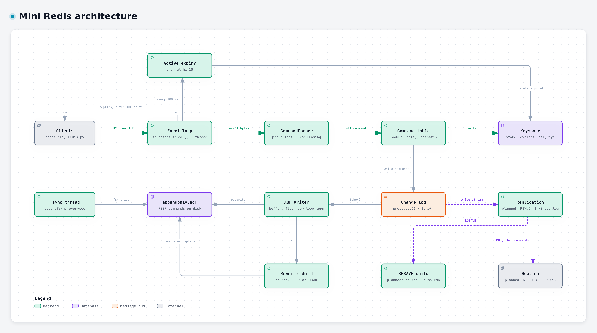

# Mini Redis

> A Redis-compatible key-value server written from scratch in Python, with no
> third-party runtime dependencies. One thread serves every client from a
> non-blocking epoll event loop, speaks RESP2 to `redis-cli`, `redis-py` and
> `redis-benchmark`, and persists data to an append-only file with configurable
> fsync and to CRC-checked RDB snapshots, both written by forked children.

> Built with Claude (Anthropic) as a pair-programming partner for design
> review, debugging, testing and documentation.



Solid lines are implemented. Dashed lines and "planned" components are in
progress. The full design is in [docs/architecture.md](docs/architecture.md).

## Key capabilities

| Area | What it does | Status |
| --- | --- | --- |
| Event loop | Single-threaded `selectors` loop (epoll on Linux). Commands run one at a time, so they are atomic without locks. Clients get write interest only while they have unsent output. | Done |
| Networking | Non-blocking sockets with per-client input and output buffers. Handles partial reads, partial writes and pipelined requests. Tested with 1,000 concurrent clients. | Done |
| Protocol | RESP2 with an incremental parser that reads each byte once, so a 10 MB value parses in one pass. Binary-safe keys and values. Redis limits of 64 KB per header line and 512 MB per bulk string. | Done |
| Commands | Strings, hashes, key management and TTLs, with Redis option semantics and byte-for-byte Redis error messages. See [supported commands](#supported-commands). | Done |
| Expiry | Lazy expiry on every lookup, plus active expiry at `hz 10` using the Redis sampling cycle (20 keys, repeat above 25% expired, 25 ms time budget). O(1) TTL key sampling. | Done |
| AOF | Every change logged as a deterministic command (`EXPIRE` becomes `PEXPIREAT`, expiry becomes `DEL`). Written once per loop turn, before replies go out. `appendfsync always`, `everysec` or `no`. | Done |
| Crash recovery | Replays the AOF, or loads `dump.rdb` when AOF is off, before accepting clients. Truncates a half-written last AOF command, so the server always restarts. Refuses to start on a corrupt snapshot. | Done |
| AOF rewrite | `BGREWRITEAOF` forks a child that writes the smallest command set for the current data. The parent buffers writes made during the rewrite, appends them, fsyncs, and swaps the file in atomically with `os.replace()`. | Done |
| RDB snapshots | `BGSAVE` forks a child that writes a CRC-checked binary file and swaps it in atomically. Save points (`--save`) with a dirty counter, a final save on shutdown, and loading at startup. One background child at a time, with Redis's replies when another is running. | Done |
| Replication | Master-replica replication over PSYNC: RDB full sync, replication offsets, and partial resync from a 1 MB backlog, verified with network fault-injection tests. | In progress |
| Shutdown | `SIGINT` and `SIGTERM` wake the loop through a wakeup fd. With save points on, the server saves `dump.rdb` first, and keeps running if that save fails. Then it stops any child, flushes and fsyncs the AOF, closes every client, and exits 0. | Done |

## Performance

`redis-benchmark -t set,get -n 100000` on an AMD Ryzen 7 7800X3D (WSL2,
Python 3.11, Redis 8.10.3), AOF off, median of 3 runs, in requests per second.
The thread-per-client column is this project's first design, commit `12e9de6`.

| Clients | Pipeline | Test | Thread-per-client | Mini Redis | Real Redis | vs. thread-per-client |
| ---: | ---: | --- | ---: | ---: | ---: | ---: |
| 50 | 1 | SET | 11,826 | 40,404 | 82,850 | 3.4x |
| 50 | 1 | GET | 12,235 | 57,405 | 81,500 | 4.7x |
| 1,000 | 1 | SET | 13,814 | 34,650 | 77,942 | 2.5x |
| 1,000 | 1 | GET | 14,747 | 55,525 | 78,802 | 3.8x |
| 1,000 | 16 | SET | 19,168 | 126,263 | 1,136,364 | 6.6x |
| 1,000 | 16 | GET | 21,039 | 142,248 | 1,204,819 | 6.8x |

With AOF on (`everysec`), Mini Redis serves 24,331 SET/s and 50,633 GET/s at
1,000 clients without pipelining. The full report, including AOF-on runs and
every raw sample, is in
[bench/results/throughput-vs-redis-2026-10-26-d225a7f.md](bench/results/throughput-vs-redis-2026-10-26-d225a7f.md).

Without pipelining, Mini Redis reaches 70% of real Redis on GET at 1,000
clients. With 16 commands per pipeline, per-command interpreter cost dominates
and real Redis is 8 to 9 times faster.

With 50 clients and no pipelining, SET reaches 14,808/s with
`appendfsync always`, 60,350/s with `everysec` and 61,690/s with `no`. During
`BGREWRITEAOF` with 1M keys under heavy writes, the event loop stops for
14 ms at the fork and 87 ms at the end, when the parent writes the 80 MB
rewrite buffer and swaps in the new file. The old AOF is closed in a
background thread, which took the end pause with no writes from 31 ms down to
9 ms. See
[bench/results/aof-fsync-and-rewrite-2026-11-09-45fe870.md](bench/results/aof-fsync-and-rewrite-2026-11-09-45fe870.md).

`BGSAVE` of 1M keys takes about 1.1 s and stops the event loop for about 6 ms
at the fork. The child copies 247 MB of the server's 304 MB (81%) even with no
writes, because CPython writes the reference count of every object the child
reads. Real Redis copies 1 MB. `gc.freeze()` before the fork did not reduce
the copying, so the server does not use it. See
[bench/results/bgsave-fork-and-cow-2026-11-09-2dde6e9.md](bench/results/bgsave-fork-and-cow-2026-11-09-2dde6e9.md)
and [section 9 of the architecture doc](docs/architecture.md#copy-on-write-cost-in-cpython).

Reproduce (Linux or WSL, needs `redis-server` and `redis-benchmark`):

```bash
python3 bench/run.py            # 3 runs per case, about 10 minutes
python3 bench/run.py --runs 1   # quick check
python3 bench/aof.py            # fsync policies and rewrite pauses, about 4 minutes
python3 bench/rdb.py            # BGSAVE fork pause and copy-on-write memory, about 4 minutes
```

## Quick start

Requires Python 3.11 or newer on Linux or macOS. Run from the project root.

```bash
python3 -m mini_redis                                   # port 6379, BGSAVE only on request
python3 -m mini_redis --aof                             # AOF on, fsync every second
python3 -m mini_redis --save "60 1000 300 10"           # snapshot after 60 s if 1,000+ writes, or 300 s if 10+
python3 -m mini_redis --port 6380 --aof --appendfsync always --aof-path data/appendonly.aof
```

In another terminal (`sudo apt install redis-tools` for `redis-cli`):

```console
$ redis-cli SET session:42 alice EX 60
OK
$ redis-cli TTL session:42
(integer) 60
$ redis-cli INCR visits
(integer) 1
$ redis-cli HSET user:1 city Hanoi
(integer) 1
$ redis-cli HGET user:1 city
"Hanoi"
$ redis-cli BGREWRITEAOF
Background append only file rewriting started
$ redis-cli BGSAVE
Background saving started
$ redis-cli LASTSAVE
(integer) 1794225600
```

With `--aof`, stop the server with Ctrl+C and start it again. The data is
still there, and `session:42` keeps its remaining TTL. Without `--aof`, the
server loads `dump.rdb` from the last `BGSAVE`, or from the final save at
shutdown when `--save` is set.

To check everything by hand, [docs/try-every-command.md](docs/try-every-command.md)
walks through every command, the error replies, snapshots, save points, the AOF
and restarts, with the output to expect at each step.

## Configuration

| Option | Default | Description |
| --- | --- | --- |
| `--host` | `127.0.0.1` | Address to listen on |
| `--port` | `6379` | Port to listen on |
| `--aof` | off | Turn on the append-only file |
| `--aof-path` | `appendonly.aof` | AOF location. The rewrite temp file goes in the same directory |
| `--appendfsync` | `everysec` | `always`, `everysec` or `no`. See [fsync policies](docs/architecture.md#fsync-policies) |
| `--rdb-path` | `dump.rdb` | Snapshot location. The `BGSAVE` temp file goes in the same directory |
| `--save` | off | Save points as `"SECONDS CHANGES ..."` pairs: save after SECONDS if at least CHANGES writes happened, and save once more on shutdown. See [save points](docs/architecture.md#save-points) |

Fixed settings in [`mini_redis/config.py`](mini_redis/config.py) match the
Redis defaults: `tcp-backlog 511`, 16 KB reads per `recv()`, and `hz 10`.

## Supported commands

| Group | Commands |
| --- | --- |
| Connection | `PING [message]`, `ECHO message` |
| Strings | `SET key value [NX \| XX] [GET] [EX s \| PX ms \| EXAT ts \| PXAT ts \| KEEPTTL]`, `GET key`, `INCR key` |
| Hashes | `HSET key field value`, `HGET key field` |
| Keys | `DEL key [key ...]`, `EXISTS key [key ...]`, `EXPIRE key seconds [NX \| XX \| GT \| LT]`, `PEXPIREAT key ms [NX \| XX \| GT \| LT]`, `TTL key`, `DBSIZE` |
| Persistence | `BGREWRITEAOF`, `BGSAVE`, `LASTSAVE` |

Replies and errors match Redis, including `WRONGTYPE` for a key of the wrong
type and `ERR value is not an integer or out of range` for bad integers.

## Running the tests

```bash
python3 -m pip install --group test              # redis-py, for the compatibility tests
python3 -m unittest discover -s tests -v
```

| File | What it covers |
| --- | --- |
| `test_resp.py` | Encoder, socket parser and file reader: split, pipelined and malformed input, and that both parsers agree |
| `test_args.py` | Strict 64-bit integer parsing and option parsing |
| `test_commands.py` | Command table, arity, and that only write commands reach the AOF |
| `test_server.py` | Real server process: shutdown on `SIGINT` and `SIGTERM`, protocol errors close the connection |
| `test_aof.py` | AOF class: crash recovery, buffering, fsync policies, background rewrite, and `BGREWRITEAOF` replies when another child runs |
| `test_aof_logging.py` | What each write command logs to the AOF |
| `test_aof_server.py` | Real server with AOF: restarts, `SIGKILL` under each fsync policy, `BGREWRITEAOF` and `SIGTERM` during a rewrite |
| `test_child.py` | The background child slot: reaping, failure exit codes, kill at shutdown, one child at a time |
| `test_rdb.py` | RDB format byte for byte, every truncation and bit flip, `BGSAVE`, `LASTSAVE`, loading, save points and the dirty counter |
| `test_rdb_server.py` | Real server with RDB: `BGSAVE`, restarts, corrupt snapshots, turning AOF on, save points, and a failing final save |
| `test_redis_py.py` | `redis-py` against a running server: pipelines, binary values, large values, many arguments, several clients |
| `test_main.py` | Command-line options and config validation |

End-to-end tests start the server as a separate process on a free port, the
same way a user runs it.

## Project structure

```text
mini_redis/
  __main__.py          command-line options
  config.py            frozen, validated server, AOF and RDB settings
  server.py            event loop, cron, before_sleep, shutdown
  client.py            per-client socket, parser and output buffer
  resp.py              RESP2 encoder, incremental parser, AOF reader
  propagation.py       log of changes for the AOF and replicas
  commands/
    registry.py        command table: name, handler, arity, write flag
    args.py            integer and option parsing
    connection.py      PING, ECHO
    strings.py         SET, GET, INCR
    hashes.py          HSET, HGET
    keys.py            DEL, EXISTS, EXPIRE, PEXPIREAT, TTL, DBSIZE
    persistence.py     BGREWRITEAOF, BGSAVE, LASTSAVE
  storage/
    keyspace.py        data, TTLs, lazy expiry, O(1) TTL sampling
    expire.py          active expiry cycle
  persistence/
    aof.py             AOF buffer, fsync policies, replay, recovery, rewrite
    rdb.py             RDB format, BGSAVE, loading at startup, save points
    child.py           the one background child: fork, reap, kill
    files.py           directory fsync
tests/                 unit and end-to-end tests
bench/
  run.py               benchmark against the old design and real Redis
  aof.py               fsync policy throughput and BGREWRITEAOF pauses
  rdb.py               BGSAVE fork pause and copy-on-write memory
  results/             saved reports, named <benchmark>-<date>-<commit>.md
docs/
  architecture.md      system design
  try-every-command.md hands-on tour of every command with redis-cli
  img/                 diagrams
```

## References

- [RESP protocol specification](https://redis.io/docs/latest/develop/reference/protocol-spec/)
- [Redis persistence](https://redis.io/docs/latest/operate/oss_and_stack/management/persistence/)
- [Redis replication](https://redis.io/docs/latest/operate/oss_and_stack/management/replication/)
- [memkv](https://github.com/quangh33/memkv) and
  [EP_redis_course](https://github.com/vietnakid/EP_redis_course), Go
  implementations used as references
