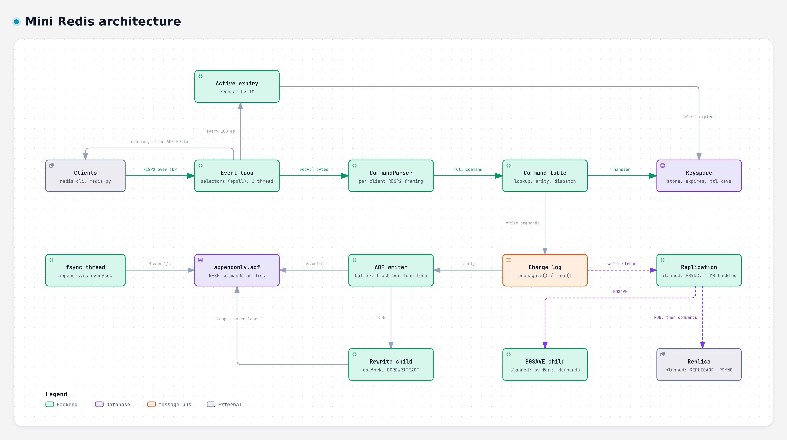

# Architecture

Mini Redis is a Redis-compatible key-value server written in Python with no
third-party runtime dependencies. It speaks RESP2, so `redis-cli`, `redis-py`
and `redis-benchmark` work against it unchanged. This document describes how
the server is built: the event loop, the protocol layer, command execution, the
keyspace, expiry, persistence and replication.



Solid lines are implemented. Dashed lines and components marked "planned" are
designed but not yet merged. Sections 9 and 10 give their status.

## Contents

1. [Design principles](#1-design-principles)
2. [Event loop](#2-event-loop)
3. [Connections and buffers](#3-connections-and-buffers)
4. [Protocol](#4-protocol)
5. [Command execution](#5-command-execution)
6. [Keyspace and expiry](#6-keyspace-and-expiry)
7. [Change propagation](#7-change-propagation)
8. [Append-only file](#8-append-only-file)
9. [RDB snapshots](#9-rdb-snapshots)
10. [Replication](#10-replication)
11. [Error replies](#11-error-replies)
12. [Testing and benchmarks](#12-testing-and-benchmarks)
13. [Limitations](#13-limitations)

## 1. Design principles

One thread owns the data. A single event loop serves every client and runs
every command from start to finish before it starts the next one. `INCR` is
atomic without locks, and no command can see another command half done. This
is the same model Redis uses, and the GIL does not limit it, because the server
never runs Python code on two threads at once.

Work that would block the loop runs elsewhere. The `everysec` fsync runs in a
background thread. AOF rewrites and RDB snapshots run in a forked child
process, which gets a copy-on-write view of the keyspace at the moment of the
fork.

The server saves a write before its reply leaves. The loop writes all of a turn's
changes to the AOF, then sends that turn's replies. A client never sees `OK`
for a write that is not yet in the file.

Keys and values stay `bytes` from the socket to the keyspace and back.
The server decodes only command names, integers and option keywords. Any byte
sequence is a valid key or value.

Each layer has one job. `server.py` holds no command names, command handlers
never touch sockets, and the persistence code reads changes from one log
instead of from each handler.

| Module | Responsibility |
| --- | --- |
| `server.py` | Event loop, accept, read, write, cron, shutdown |
| `client.py` | Per-connection state: socket, parser, output buffer |
| `resp.py` | RESP2 encoder, incremental socket parser, file reader for AOF replay |
| `commands/` | Command table and one handler per command |
| `storage/keyspace.py` | The data, TTLs, lazy expiry, O(1) TTL sampling |
| `storage/expire.py` | Active expiry cycle |
| `propagation.py` | Log of changes made by the running command |
| `persistence/aof.py` | AOF buffer, fsync policies, replay, crash recovery, rewrite |
| `config.py` | Frozen, validated server and AOF settings |
| `__main__.py` | Command-line options |

## 2. Event loop

The loop is built on `selectors.DefaultSelector`, which uses epoll on Linux and
kqueue on macOS. One turn of the loop does this:

1. Wait on the selector. The timeout is the time until the next cron tick, so
   periodic work runs even when no client sends anything.
2. For each ready socket:
   - The listener is readable. Accept the client, make its socket
     non-blocking, and register it for read events.
   - The wakeup socket is readable. A signal arrived. Drain the socket.
   - A client is readable. Read up to 16 KB, feed it to the client's parser,
     and run every complete command in it.
   - A client is writable. Send as much of its output buffer as the kernel
     accepts.
3. If a cron tick is due, run it. Cron runs `hz` times per second (10 by
   default). It checks whether an AOF rewrite child has exited and runs the
   active expiry cycle.
4. Run `before_sleep()`. It writes the turn's buffered AOF data to the file,
   then sends the pending replies of every client that sent commands this
   turn.

```text
select(timeout = next cron tick)
  ├─ accept new clients
  ├─ read → parse → execute → append reply to outbuf
  ├─ send leftover output for writable clients
  ├─ cron: rewrite child status, active expiry
  └─ before_sleep: AOF write (+ fsync if always), then send replies
```

Shutdown is signal-driven. `SIGINT` and `SIGTERM` handlers only record the
signal. `signal.set_wakeup_fd()` writes a byte to a socket pair that the
selector watches, so `select()` returns at once. The loop then exits, stops any
rewrite child, flushes and fsyncs the AOF, closes every socket, and exits with
code 0.

## 3. Connections and buffers

TCP is a byte stream. One `recv()` can return half a command or ten commands,
and one `send()` can accept part of a reply. Each client keeps its own state in
`Client`:

| Field | Purpose |
| --- | --- |
| `sock` | The non-blocking client socket |
| `parser` | A `CommandParser` holding bytes received but not yet parsed |
| `outbuf` | Reply bytes not yet sent |
| `closing` | Set after a protocol error. The server closes the client once `outbuf` is empty |

Clients register for write events only while `outbuf` has bytes. A socket with
nothing to send would otherwise report writable on every turn and spin the
loop at 100% CPU. The server calls `selector.modify()` (one `epoll_ctl`) only
when the event mask changes.

`BlockingIOError` from `recv()`, `send()` or `accept()` means "try again on a
later event". `ECONNRESET`, other socket errors, and a zero-byte read close the
client. The listen backlog is 511, the Redis `tcp-backlog` default.

## 4. Protocol

Requests are RESP2 arrays of bulk strings. Replies use simple strings, errors,
integers, bulk strings, null bulk strings and arrays.

`CommandParser` turns the socket stream into commands. It keeps its progress
between `feed()` calls (arguments read so far, arguments left, and the length
of the next bulk string), so it reads each byte once. A parser that restarts
from the beginning of the buffer on every `recv()` is O(n²) on a large value.
At 16 KB per read, a 10 MB value took minutes. Redis uses the same approach in
`processMultibulkBuffer()`.

The parser returns one of three results:

- A complete command.
- `None`, meaning the buffer ends mid-command. The bytes stay buffered until
  the next read.
- A `ProtocolError`. The server replies `-ERR Protocol error: <reason>` and
  closes the connection once the reply has gone out, because it can no longer find
  where the next command starts.

The AOF loader reads from a file, so it uses the simpler blocking
`RESPReader`. Both parsers accept and reject the same inputs, and
`tests/test_resp.py` checks that they agree. A header line can be at most
64 KB and a bulk string at most 512 MB, the same limit as Redis
`proto-max-bulk-len`.

## 5. Command execution

Each command is one entry in the command table in `commands/registry.py`, the
same idea as `redisCommandTable` in Redis:

```python
@dataclass(frozen=True)
class Command:
    name: str
    handler: Callable[[list[Value]], Value]  # args without the name -> reply
    arity: int     # 2 means exactly 2 items incl. the name; -2 means at least 2
    write: bool = False
```

For every request, `execute()`:

1. Looks up the command by name, case-insensitive. A missing name replies
   `-ERR unknown command`.
2. Checks arity. A wrong count replies `-ERR wrong number of arguments`.
3. Calls the handler. A `CommandError` from the handler, such as `WRONGTYPE`
   or a bad integer, becomes an error reply.
4. Collects the changes the handler recorded and appends them to the AOF
   buffer.

An unexpected exception in a read command becomes an error reply. In a write
command it stops the server. The keyspace may be half changed while the AOF
has no record of it, and a restart rebuilds the data from the AOF, which only
holds commands that finished.

Supported commands:

| Group | Commands |
| --- | --- |
| Connection | `PING`, `ECHO` |
| Strings | `SET` (with `NX`, `XX`, `GET`, `EX`, `PX`, `EXAT`, `PXAT`, `KEEPTTL`), `GET`, `INCR` |
| Hashes | `HSET`, `HGET` |
| Keys | `DEL`, `EXISTS`, `EXPIRE` (with `NX`, `XX`, `GT`, `LT`), `PEXPIREAT`, `TTL`, `DBSIZE` |
| Persistence | `BGREWRITEAOF` |

Adding a command means writing a handler and adding one line to the table.

## 6. Keyspace and expiry

```python
store:    dict[bytes, tuple[str, object]]  # key -> (type tag, data)
expires:  dict[bytes, int]                 # key -> deadline, ms since epoch
ttl_keys: list[bytes]                      # keys with a TTL, any order
ttl_pos:  dict[bytes, int]                 # key -> index in ttl_keys
```

The type tag (`"string"` or `"hash"`) lets commands reply `WRONGTYPE` when a
key holds the wrong kind of value. Deadlines are absolute milliseconds, so a
TTL means the same thing after a restart.

The server removes expired keys in two ways, as Redis does.

Lazy expiry runs on access. Every lookup goes through `lookup_key()`, which
deletes the key if its deadline has passed and reports it as missing.

Active expiry runs on cron, for keys that nobody reads again. Each cycle:

1. Samples 20 keys from `ttl_keys`.
2. Deletes the ones that have expired.
3. Repeats while more than 5 of the 20 (25%) were expired.
4. Every 16 rounds, checks the clock and stops once it has used 25% of a cron
   tick (25 ms at `hz 10`), so the loop never stalls on a large backlog.

Sampling a random key from a dict needs `list(d)`, which is O(n). `ttl_keys`
and `ttl_pos` make sampling O(1) per key. Removing a TTL swaps the last key
into the freed slot, so removal is also O(1).

## 7. Change propagation

Handlers record each change by calling `propagate()` at the moment they change
the data. After each command, the server calls `take()` and passes the
recorded changes to the AOF. Replication reads the same log (section 10).

Each change is recorded as a command that gives the same result whenever it
is replayed, not as the command the client sent:

| Client sends | Recorded as |
| --- | --- |
| `EXPIRE k 10` | `PEXPIREAT k <deadline ms>` |
| `SET k v EX 10` | `SET k v PXAT <deadline ms>` |
| `SET k v` with a deadline in the past | `DEL k` |
| A key expires, lazily or actively | `DEL k` |
| `DEL a b c` where only `a` exists | `DEL a` |

Replaying the AOF next week therefore gives the same data as running the
commands today. A key that expired before the restart stays deleted.

## 8. Append-only file

### Write path

`AOF.write()` appends the RESP bytes of each change to an in-memory buffer.
`before_sleep()` calls `AOF.flush()` once per loop turn, which writes the
buffer with `os.write()` on a file opened with `O_APPEND`. Then the replies go
out. One write per turn instead of one per command keeps the cost of
pipelined and concurrent writes low.

### fsync policies

The `--appendfsync` option matches the Redis setting of the same name:

| Policy | When fsync runs | Data lost in a power failure |
| --- | --- | --- |
| `always` | In `flush()`, before the server sends the turn's replies | None that a client saw acknowledged |
| `everysec` (default) | Once per second, in a background thread | Up to about 1 second of writes |
| `no` | When the kernel decides | Up to the kernel's writeback interval |

A crash of the server process alone loses nothing under any policy once
`flush()` has returned, because the data is already in the kernel page cache.

### Startup and crash recovery

On startup, before the listener opens, the server replays the AOF through the
command table. Clients never see a half-loaded dataset. The loader uses the
same parsing rules as client input, so the AOF cannot replay something a
client could not have sent. The loader accepts only write commands, and stops
the server if one fails, because either case means the file is damaged.

A crash in the middle of `os.write()` can leave half a command at the end of
the file. The loader replays every complete command, then truncates the file at
the end of the last good one, so new writes are not appended after broken
bytes.

### Rewrite (`BGREWRITEAOF`)

The AOF grows with every write. `INCR counter` run a million times leaves a
million entries for one key. A rewrite replaces the file with the shortest list
of commands that rebuilds the current data: one `SET` per string key, one
`HSET` per hash field, and a `PEXPIREAT` per key with a TTL.

1. The parent forks. The child serializes its copy-on-write view of the
   keyspace to `temp-rewrite.aof`, fsyncs it, and exits.
2. The parent keeps serving clients. It writes every new change to the
   current AOF as usual, and also copies it to a rewrite buffer.
3. Cron checks the child with `waitpid(WNOHANG)`. When the child exits with
   status 0, the parent appends the rewrite buffer to the temp file, fsyncs it,
   swaps it in with `os.replace()`, and fsyncs the directory.
4. The parent switches its file descriptor to the new file under a lock shared
   with the fsync thread.

`os.replace()` is atomic on POSIX. A crash at any point leaves either the old
complete AOF or the new complete AOF. If the child fails, the parent deletes
the temp file and keeps the old AOF. Shutdown kills a running child and
removes its temp file.

Redis 7 and later splits the AOF into a base file, incremental files and a
manifest. Mini Redis keeps a single file, which needs no manifest and still
gives the same crash guarantees.

## 9. RDB snapshots

Status: in progress.

`BGSAVE` writes the whole dataset to one binary file, `dump.rdb`. Snapshots are
smaller and faster to load than an AOF, and replication uses them for a full
sync.

1. The parent forks. The child sees the data as it was at the fork.
2. The child writes every key to `temp.rdb`, fsyncs it, and exits.
3. The parent keeps serving clients. Cron reaps the child with
   `waitpid(WNOHANG)`, then the parent renames `temp.rdb` to `dump.rdb` with
   `os.replace()` and fsyncs the directory.

File format:

```text
"MINIRDB" | version u8 | record* | EOF u8 | CRC32 u32 of all previous bytes
record    = type u8 | expire_ms i64 (-1 = none) | key_len u32 | key | value
value     = string: len u32 | bytes
            hash:   count u32 | (field_len u32 | field | value_len u32 | value)*
```

The loader rejects a file with a bad magic, an unknown version or a CRC
mismatch, and skips keys whose deadline has passed. On startup, the server
loads the AOF if AOF is on, because the AOF is the more complete record.
Otherwise it loads `dump.rdb` if it exists.

CPython's reference counting writes to every object it touches, which breaks
copy-on-write page sharing sooner than in C. Calling `gc.freeze()` before the
fork moves existing objects out of the garbage collector's reach, so a GC pass
in the parent does not touch every page. The snapshot benchmark measures fork
time and memory growth for 1M keys with and without it.

## 10. Replication

Status: in progress.

A replica keeps a full copy of the master's data and applies the master's
write stream. The protocol follows Redis PSYNC.

```text
replica                                  master
   │  REPLICAOF host port                   │
   │──── PING, REPLCONF, PSYNC <id> <off> ─▶│
   │                                         │ id and offset still in backlog?
   │◀──── +CONTINUE, then missing bytes ─────│   yes: partial resync
   │◀──── +FULLRESYNC <id> <off>, RDB ───────│   no:  full sync
   │◀──── write commands (RESP) ─────────────│ propagate() → backlog → replicas
   │──── REPLCONF ACK <offset> every 1 s ───▶│
```

Full sync. The master starts a `BGSAVE` and buffers new writes for the
replica. It sends the RDB file as a bulk payload, then the buffered writes,
then the live stream. The replica clears its data, loads the RDB, and applies
the stream.

Command stream. The master sends every change from the propagation log
(section 7) to each replica, in the same RESP form it writes to the AOF. The
replica runs each command through its own command table without sending
replies back.

Offsets and backlog. The master has a replication ID and an offset, the total
bytes of the command stream it has produced. It keeps the last 1 MB of the
stream in a ring buffer. The replica tracks the offset it has applied and
reports it with `REPLCONF ACK`.

Partial resync. After a disconnect, the replica sends
`PSYNC <replication id> <offset + 1>`. If the ID matches and the offset is
still in the backlog, the master replies `+CONTINUE` and sends only the bytes
the replica missed. Otherwise it falls back to a full sync.

Replicas are read-only and reject write commands from clients. The replica
connection is one more non-blocking socket in the event loop, so replication
adds no threads.

Fault-injection tests run master and replica as real processes with a TCP
proxy between them. The proxy drops, pauses and cuts the link. The tests check
that the replica matches the master after recovery, and that a short outage
ends in a partial resync, not a full one.

## 11. Error replies

| Situation | Reply | Connection |
| --- | --- | --- |
| Incomplete request | None, wait for more bytes | Open |
| Malformed RESP | `-ERR Protocol error: <reason>` | Closed after the reply |
| Unknown command | `-ERR unknown command 'X'` | Open |
| Wrong number of arguments | `-ERR wrong number of arguments for 'x' command` | Open |
| Wrong type | `-WRONGTYPE Operation against a key holding the wrong kind of value` | Open |
| Bad integer | `-ERR value is not an integer or out of range` | Open |
| `BGREWRITEAOF` with AOF off | `-ERR AOF is not enabled` | Open |

## 12. Testing and benchmarks

Unit tests cover the parsers (split, pipelined and malformed input), argument
parsing and command handlers. End-to-end tests start the server as a separate
process on a free port and talk to it with `redis-py` and with raw sockets.

Crash tests cut bytes off the AOF at chosen points to simulate a crash during a
write, restart the server, and check the data. Others `SIGKILL` the server
under each `appendfsync` policy and check that every acknowledged write is
back after a restart. AOF tests check what each command writes to the file,
and run `BGREWRITEAOF` with writes during the rewrite, a failing child, and a
shutdown in the middle. Shutdown tests send `SIGINT` and `SIGTERM` and check
that the AOF is complete and every client is closed.

`bench/run.py` runs `redis-benchmark` against Mini Redis, the earlier
thread-per-client version of this server, and real Redis on the same machine,
with AOF on and off, at 50 and 1,000 clients, with and without pipelining.
`bench/aof.py` measures SET throughput for each `appendfsync` policy, and how
long the event loop stops at the fork and at the end of `BGREWRITEAOF`, using a
client that sends one `PING` at a time. Both save each report under
`bench/results/` with the date, commit, CPU, kernel and versions. See the
[README](../README.md#performance) for the current numbers.

## 13. Limitations

- Data types are strings and hashes only. There is one database, with no
  `SELECT`.
- Inline commands (plain-text `PING` from `telnet`) are not supported.
- There is no client output buffer limit, `maxmemory` or eviction policy.
- `os.fork()` limits the server to Linux and macOS.
- CPython is slower than C. At 1,000 clients without pipelining, Mini Redis
  reaches about 70% of real Redis throughput on `GET` and 45% on `SET`. With 16
  commands per pipeline, per-command interpreter cost dominates and real Redis
  is 8 to 9 times faster.

## References

- [RESP protocol specification](https://redis.io/docs/latest/develop/reference/protocol-spec/)
- [Redis persistence](https://redis.io/docs/latest/operate/oss_and_stack/management/persistence/)
- [Redis replication](https://redis.io/docs/latest/operate/oss_and_stack/management/replication/)
- [Python `selectors`](https://docs.python.org/3/library/selectors.html)
- [Python `os.fork`](https://docs.python.org/3/library/os.html#os.fork)
