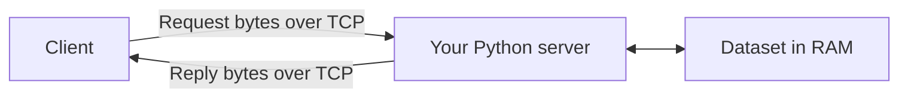
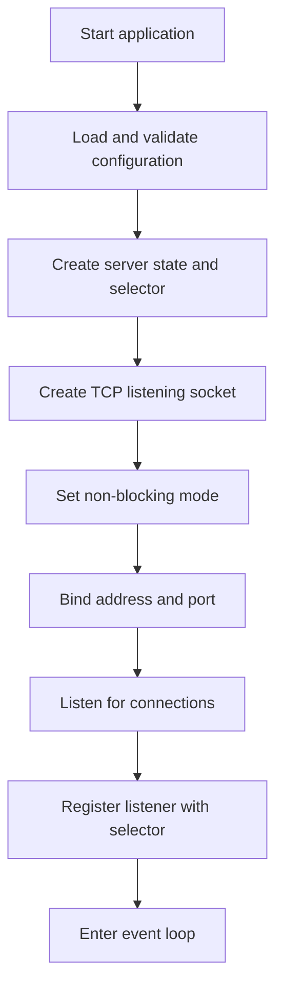
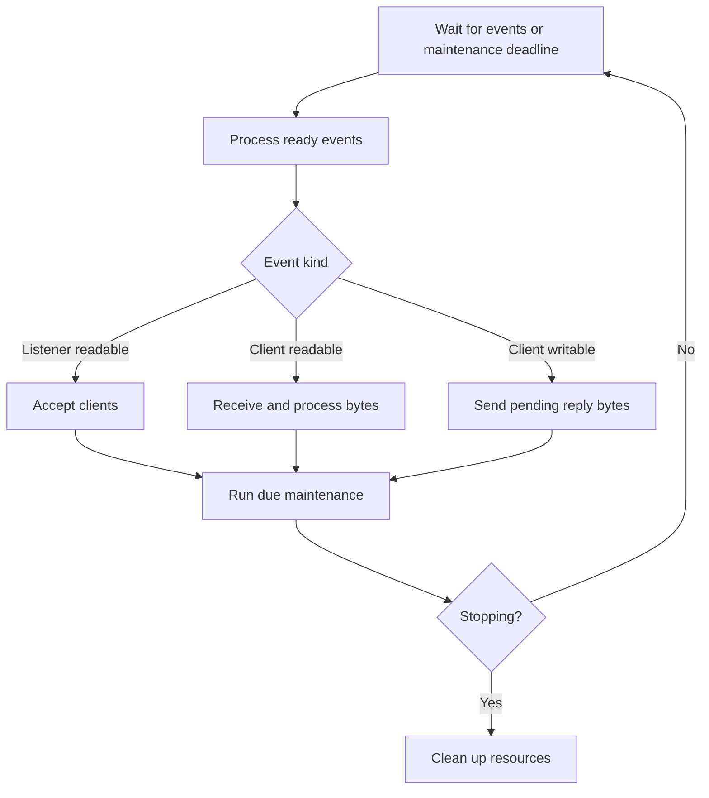
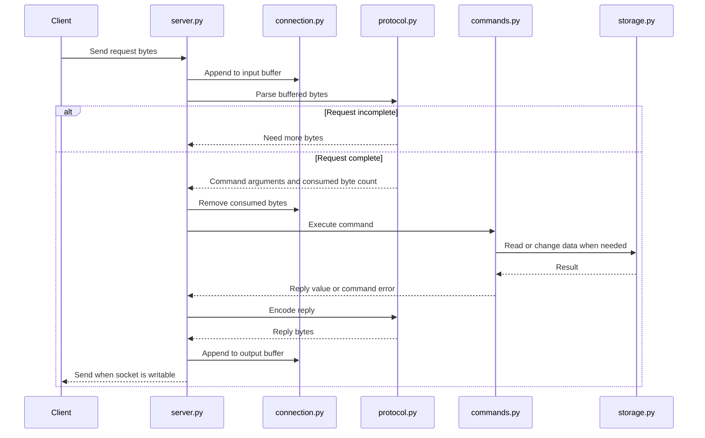

# Mini Redis architecture

This document describes the proposed design for your Python Redis-style server.
The project currently contains a scaffold, with no working server or implemented
tests. The components below are a plan, not a claim that these features exist.

The first goal is a server that starts, accepts multiple clients, and shuts down
cleanly. After that, add RESP parsing, then commands and storage.

## 1. What you are building

Your server is a Python process that receives commands over TCP, operates on data
in memory, and sends replies. A client can be a small Python test program or,
once the protocol is supported, `redis-cli`.



You write the connection handling, protocol parser, command behavior, and storage
logic. Python and the operating system provide sockets, network transport, and
filesystem access. The official Redis server is not required to run your server.

Initial choices:

| Area | Proposed choice | Reason |
| --- | --- | --- |
| Language | Python 3.11 or newer | Matches `pyproject.toml`. |
| Networking | Standard-library `socket` | Provides TCP connections. |
| Event handling | `selectors.DefaultSelector` | Waits for socket readiness without polling every client manually. |
| Concurrency | One event loop and one owner of the dataset | Makes command ordering and shared state easier to reason about. |
| Storage | Python dictionary initially | Lets you finish the full request flow before writing a hash table. |
| Protocol | A documented RESP2 subset | Allows testing supported commands with Redis clients. |
| Tests | Standard-library `unittest` and socket clients | Supports both isolated logic tests and real network tests. |
| Environment | Windows or Linux | The initial design uses sockets supported on both. |

No thread per client is needed in this design. An idle client should not prevent
another client from making progress. Implementing your own hash table can be a
later storage exercise behind the same storage interface.

## 2. Files and responsibilities

The repository root is `E:\redis-from-sratch`. Python source lives in `mini_redis`.

```text
redis-from-sratch/
|-- architecture.md
|-- README.md
|-- pyproject.toml
|-- .gitignore
|-- mini_redis/
|   |-- __init__.py
|   |-- __main__.py
|   |-- config.py
|   |-- server.py
|   `-- connection.py
`-- tests/
    |-- __init__.py
    `-- test_server.py
```

| File | Owns | Boundary |
| --- | --- | --- |
| `__main__.py` | Application startup and top-level exit handling | Delegates networking to the server. |
| `config.py` | Settings and their validation | Does not open sockets. |
| `server.py` | Listener, selector, event loop, client registry, resource cleanup | Coordinates work without parsing RESP itself. |
| `connection.py` | One client's socket, input/output buffers, connection state | Does not own the shared dataset. |
| `tests/test_server.py` | End-to-end connection and lifecycle checks | Observes behavior through actual sockets. |
| `README.md` | Setup, starting the project, and supported features | Describes what currently works. |
| `pyproject.toml` | Project metadata and Python requirement | Does not hold server runtime state. |

Add these files when their features are needed:

| Future file | Responsibility |
| --- | --- |
| `protocol.py` | Parse request bytes and encode result values as RESP replies. |
| `commands.py` | Dispatch commands, validate arguments, and perform operations. |
| `storage.py` | Own key-value data and later expiration metadata. |
| `tests/test_protocol.py` | Check valid, invalid, incomplete, and combined requests. |
| `tests/test_commands.py` | Check command behavior and errors. |
| `tests/test_storage.py` | Check storage and expiration behavior. |

## 3. Startup flow



Start with a bind address of `127.0.0.1` and port `6379`. This accepts connections
from your own computer. Later settings should include client and buffer limits.

Creating a socket allocates a network endpoint. Binding assigns its local address
and port. Listening allows incoming connection attempts to queue for acceptance.
Accepting creates a separate socket for communication with one client.

Only report the server as ready after initialization succeeds. If binding fails,
for example because the port is occupied, report the error and release resources
already opened.

## 4. The event loop

The selector reports sockets that are ready for an operation. The event loop
handles that work and then waits again. It can handle many connections without
creating a thread for each one.



The diagram groups event handling conceptually. One selector result can contain
many sockets, and one client can be both readable and writable.

Rules for this loop:

- Set the listener and every accepted socket to non-blocking mode.
- Treat an operation that would block as a reason to try again on a later event.
- Watch for write readiness only when there are queued reply bytes.
- Limit work per client per turn so one busy client does not monopolize the loop.
- If complete requests remain in an input buffer after that limit, schedule them
  for another turn. Do not wait for new network data to process bytes already held.
- When timers exist, choose a wait timeout that lets maintenance run even if no
  clients send data. Avoid an endless zero-timeout loop when there is no work.

## 5. Connection state and buffers

There is one listener and one connection record per client.

| Per-client state | Purpose |
| --- | --- |
| Socket | Exchanges bytes with that client. |
| Input buffer | Holds received bytes that have not been fully consumed. |
| Output buffer | Holds reply bytes that have not been sent. |
| Parser progress, if needed | Tracks an incomplete request. |
| Connection state | Tracks whether the connection is active or closing. |

TCP delivers an ordered byte stream, not separate Redis messages. One receive
operation can contain half a command, a whole command, or several commands.
Likewise, a send operation can accept only part of a reply.

Keep incomplete input and unsent output. Each client must have its own buffers.
Enforce buffer limits; the initial policy can close connections that exceed them.

## 6. Request and response flow



For example, a request to store the value Alice under the key `user:42:name`
passes through parsing, argument validation, a storage update, and reply encoding.
A later read follows the same path but retrieves the stored value.

Keep protocol errors and command errors distinct:

| Situation | Proposed behavior |
| --- | --- |
| Incomplete request | Keep the bytes and wait for more. |
| Malformed RESP | Queue a protocol error if possible, then close the connection using bounded cleanup. |
| Unknown command | Reply with an error and keep the connection open. |
| Invalid command arguments | Reply with an error without changing storage. |
| Wrong value type | Reply with a type error. |
| Client closes or resets connection | Release its state without stopping the server. |

The parser should return complete requests, incomplete input, or protocol errors.
It should also identify how many bytes a complete request consumed. It does not
need to know whether a command exists or what the dataset contains.

## 7. Commands and storage

Start with `PING`, which needs no dataset. Then implement a small, explicitly
documented subset of `SET` and `GET`. Add `DEL`, `EXISTS`, and `TYPE` afterward.
Reject unsupported options instead of silently ignoring them.

The command layer chooses the operation and validates its arguments. The storage
layer owns data. Neither needs access to client sockets.

Initially, keep keys and string values as bytes. This preserves binary data and
avoids assuming every value is UTF-8 text. A missing key must be distinguishable
from a present key whose value is empty.

One event loop owns the dataset. An ordinary command executes to completion
before the next ordinary command changes the data. This makes a single increment
operation atomic with respect to other commands. A separate read followed by a
write is still two operations, and another client can act between them.

Pipelining means a client sends several requests before waiting for replies.
Preserve request and reply order within a connection. There is no global arrival
order across different connections.

## 8. Expiration, persistence, and multiple servers

These are later stages, not requirements for server initialization.

| Feature | What you will need to build |
| --- | --- |
| Expiration | Deadlines, access-time checks, bounded periodic cleanup, and rules for overwrites. |
| Memory limits | Accounting, write rejection, and eventually an eviction policy. |
| Additional types | Structures and operations for hashes, lists, sets, and sorted sets. |
| Persistence | Snapshot or append-only log format, startup recovery, flush policy, and crash handling. |
| Replication | Initial synchronization, ordered change delivery, and recovery after reconnecting. |
| Automatic failover | Failure detection and coordination of primary promotion. |
| Sharding | Key placement, routing, data movement, and cross-shard operation rules. |

Expiration removes data that has reached its deadline. Eviction removes eligible
data to reclaim memory. Persistence restores data after restart. Replication
copies data to another server. Sharding divides data across servers.

For the first in-memory version, a successful write means the running process
accepted the update. It does not mean the data will survive a crash. Define any
stronger durability guarantee when persistence is implemented.

## 9. Shutdown and cleanup

For the initial version, use immediate cleanup:

1. Mark the server as stopping and stop accepting clients.
2. Unregister and close client sockets.
3. Remove connection records and their buffers.
4. Unregister and close the listening socket.
5. Close the selector and exit.

Pending replies may be discarded during this initial shutdown policy. Later,
graceful shutdown can drain output with a deadline and finish persistence work.
Cleanup must also work after partially completed startup.

## 10. Build order and completion checks

| Stage | Work | Evidence it works |
| --- | --- | --- |
| 1 | Configuration, listener, startup, shutdown | Starts on a configured port, reports an occupied port, and exits cleanly. |
| 2 | Selector and connection records | Two clients connect; an idle client does not block the other. |
| 3 | Buffers and disconnection handling | Partial network transfers preserve bytes; one disconnect does not stop the server. |
| 4 | RESP parser, encoder, and `PING` | Split requests and pipelined requests produce complete, ordered replies. |
| 5 | String storage and initial commands | One client writes a value and another reads it; missing and empty values differ. |
| 6 | Expiration and limits | Expired values are never returned; oversized input and slow readers have bounded memory use. |
| 7 | Persistence | Restart and crash tests recover data according to the documented guarantee. |

Use real TCP connections for lifecycle and end-to-end tests. Let tests bind to
port `0` so the operating system selects an available port, then connect to the
actual bound port. Wait for a ready signal with a timeout instead of relying on
fixed sleeps. Always release resources even when a test fails.

Use isolated tests for parser boundaries and command behavior. A small Python
socket client lets you deliberately split requests or send invalid data.
`redis-cli` is useful once RESP works, but it is optional and does not replace
those tests.

The first finished milestone is simple: start the server, connect two clients,
disconnect either one, and shut down without leaking sockets or hanging.

## References

- [Python sockets](https://docs.python.org/3/library/socket.html)
- [Python selectors](https://docs.python.org/3/library/selectors.html)
- [Redis serialization protocol](https://redis.io/docs/latest/develop/reference/protocol-spec/)
- [Redis CLI](https://redis.io/docs/latest/develop/tools/cli/)
- [Redis persistence](https://redis.io/docs/latest/operate/oss_and_stack/management/persistence/)
