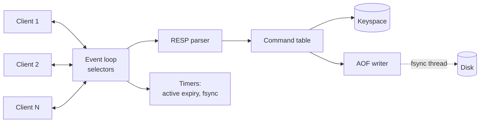
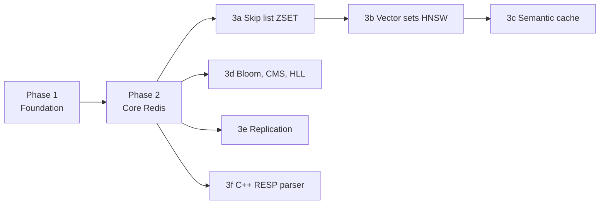

# Mini Redis architecture

Mini Redis is a Redis-compatible server written in Python. It speaks RESP2, so
`redis-cli` and `redis-py` can talk to it. The goal is to learn how Redis works
inside: the event loop, the protocol, expiry, persistence, and data structures.
Later phases add vector search, probabilistic structures, replication, and a
C++ extension.

This document has three parts:

1. Where the code is today.
2. The target design.
3. The roadmap, in four phases.

## 1. Where the code is today

Implemented:

| File | What works |
| --- | --- |
| `resp.py` | RESP2 parser and encoder for arrays, bulk strings, simple strings, integers, and errors. |
| `commands/` | `PING`, `SET`, `GET`, `HSET`, `HGET`, and the command table with arity checks and a `write` flag. |
| `storage/keyspace.py` | One global dict and a lock that hold every key. |
| `persistence/aof.py` | Append-only file. Writes each `SET`/`HSET`, flushes and fsyncs once per second, replays on startup. |
| `server.py` | TCP server with one thread per client and a global lock. |
| `__main__.py` | Command-line options: `--host`, `--port`, `--aof`, `--aof-path`. |
| `tests/test_aof.py` | 6 tests for AOF crash recovery. |

## 2. Target design

### 2.1 One thread owns the data

Redis runs every command on one thread. This server does the same:

- One event loop, built on `selectors.DefaultSelector` (epoll on Linux).
- One thread owns the keyspace. A command runs from start to finish before the
  next one starts, so `INCR` is atomic without locks.
- Background work that would block the loop (fsync, snapshots) runs in a
  separate thread or a forked child process.

Python's GIL does not hurt this design. Redis is single-threaded by choice, and
the GIL only blocks running Python code in two threads at the same time.



### 2.2 Event loop

Each loop turn:

1. Wait on the selector. The timeout is the time until the next timer is due,
   so expiry runs even when no client sends anything.
2. For each ready socket:
   - Listener readable: accept the new client, set it non-blocking, register it.
   - Client readable: read into its input buffer, then parse and run every
     complete command in the buffer.
   - Client writable: send as much of its output buffer as the socket accepts.
3. Run due timers (active expiry, AOF fsync for `everysec`).

Rules:

- All sockets are non-blocking. `BlockingIOError` means "try again on the next
  event", not an error.
- Register a client for write events only while its output buffer has bytes.
  Otherwise the loop spins at 100% CPU.
- Cap the commands run per client per turn (for example 100) so one busy client
  cannot starve the others.

### 2.3 Connections and buffers

TCP is a byte stream. One `recv()` can return half a command, one command, or
ten commands. One `send()` can accept only part of a reply.

`client.py` holds the state for one client:

| Field | Purpose |
| --- | --- |
| `sock` | The client socket. |
| `inbuf: bytearray` | Bytes received but not yet parsed. |
| `outbuf: bytearray` | Reply bytes not yet sent. |
| `closing: bool` | Set after a protocol error. Close once `outbuf` is empty. |

The parser works on `inbuf` and returns one of three results:

- A complete command, plus the number of bytes it used. The server removes
  those bytes from `inbuf`.
- "Need more bytes". Keep `inbuf` as it is and wait.
- A protocol error. Reply with `-ERR Protocol error`, then close.

Limits: close a client whose `inbuf` or `outbuf` passes a configured size.
Redis uses 1 GB for input (`client-query-buffer-limit`).

### 2.4 Protocol

- RESP2 arrays of bulk strings for requests.
- Inline commands (`PING\r\n`) so `telnet` works.
- Keys and values stay as `bytes` from the parser to the keyspace. Decode only
  for logging.

### 2.5 Command table

Each command is one entry in a table, as in Redis's `commands.def`:

```python
@dataclass(frozen=True)
class Command:
    name: bytes          # b"SET"
    handler: Callable    # handler(db, args) -> reply
    arity: int           # 3 means exactly 3 args incl. name; -3 means at least 3
    flags: frozenset     # {"write"}, {"readonly"}, {"fast"}
```

The server only does this:

1. Look up the command. If missing, reply `-ERR unknown command`.
2. Check arity. If wrong, reply `-ERR wrong number of arguments`.
3. Call the handler.
4. If the command has the `write` flag and it succeeded, append it to the AOF.

No command names appear in `server.py`.

### 2.6 Keyspace

```python
class Keyspace:
    data: dict[bytes, RedisObject]   # key -> value
    expires: dict[bytes, int]        # key -> deadline in ms since epoch
```

`RedisObject` holds a type tag (`string`, `hash`, `zset`, `vectorset`, ...)
and the value. Keeping deadlines in a separate dict makes active expiry cheap:
it samples only keys that have a TTL.

### 2.7 Error replies

| Situation | Reply | Connection |
| --- | --- | --- |
| Incomplete request | none, wait | open |
| Malformed RESP | `-ERR Protocol error` | close |
| Unknown command | `-ERR unknown command 'X'` | open |
| Wrong number of args | `-ERR wrong number of arguments for 'x' command` | open |
| Wrong type | `-WRONGTYPE Operation against a key holding the wrong kind of value` | open |
| Not an integer (INCR) | `-ERR value is not an integer or out of range` | open |

### 2.8 Target layout

```text
mini_redis/
  __main__.py          argparse: --port, --aof, --appendfsync, --dir
  config.py
  server.py            event loop, timers, shutdown
  client.py            per-client buffers
  resp.py              parser and encoder
  commands/
    registry.py        Command table
    connection.py      PING ECHO
    strings.py         SET GET INCR ...
    keys.py            DEL EXISTS EXPIRE TTL TYPE
    hashes.py
    zsets.py           (phase 3)
    vectors.py         (phase 3)
    probabilistic.py   (phase 3)
  storage/
    keyspace.py
    expiry.py
    skiplist.py        (phase 3)
    hnsw.py            (phase 3)
    bloom.py cms.py hll.py   (phase 3)
  persistence/
    aof.py
    rdb.py             (phase 2)
  replication.py       (phase 3)
tests/
bench/                 benchmark scripts and saved results
```

## 3. Roadmap



Each step has a "done when" check. A step is finished only when that check is
an automated test or a saved benchmark result.

### Phase 1: Foundation

Move to the target design before adding features.

| Step | Work | Done when |
| --- | --- | --- |
| 1.1 | Keys and values as `bytes` | `SET k "\xff\xfe"` then `GET k` returns the same bytes. |
| 1.2 | `selectors` event loop and `client.py` buffers | A command split across two `send()` calls works. 100 clients connected at once, one idle client does not block the others. |
| 1.3 | Command table with arity and flags | `server.py` contains no command names. |
| 1.4 | `__main__.py` with argparse | `python -m mini_redis --aof` starts with AOF on. |
| 1.5 | Clean shutdown on SIGINT and SIGTERM | AOF is flushed and fsynced, all sockets closed, exit code 0. |
| 1.6 | Compatibility tests with `redis-py` | The test suite uses `redis.Redis(port=...)` against this server. |
| 1.7 | First benchmark | `redis-benchmark -t set,get -n 100000` results saved in `bench/` for this server and for real Redis on the same machine. |

### Phase 2: Core Redis

#### 2.1 Commands

| Command | Notes |
| --- | --- |
| `DEL key [key ...]` | Returns the number of keys removed. |
| `EXISTS key [key ...]` | Counts a key twice if it is given twice, as Redis does. |
| `EXPIRE key seconds` | Returns 1 if set, 0 if the key does not exist. |
| `TTL key` | -2 if the key does not exist, -1 if it has no TTL. |
| `INCR key` | Error if the value is not a 64-bit integer. Creates the key with 1 if missing. |
| `SET key value [EX s \| PX ms] [NX \| XX]` | `NX`: only set if missing. `XX`: only set if present. Returns nil when the condition fails. A plain `SET` removes any old TTL. |

Done when: each command has tests for its normal case, missing key, wrong type,
and wrong arguments, and the replies match real Redis byte for byte.

#### 2.2 Expiry

Redis removes expired keys in two ways. This server does both.

Lazy expiry: every read or write of a key first checks `expires`. If the
deadline has passed, delete the key and act as if it never existed.

Active expiry (the classic Redis algorithm): 10 times a second,

1. Pick 20 random keys from `expires`.
2. Delete the ones that have expired.
3. If more than 25% of them were expired, repeat from step 1.
4. Stop after 25 ms so the loop is never blocked for long.

Without active expiry, keys that are never read again would stay in memory
forever.

Done when:

- A key with `PX 50` returns nil after 60 ms.
- After setting 100,000 keys with a 1 s TTL and never reading them, memory use
  goes back down within a few seconds.

Note: picking a random key from a dict needs `list(d)`, which is O(n). Keep a
list of keys with TTLs next to the dict, and remove by swapping with the last
item so removal is O(1).

#### 2.3 AOF done properly

fsync policies, as in Redis's `appendfsync` setting:

| Policy | When fsync runs | Data lost on a crash | Speed |
| --- | --- | --- | --- |
| `always` | After every write command, before the reply | At most the command being written | Slowest |
| `everysec` | Once per second, in a background thread | Up to about 1 second of writes | Default |
| `no` | When the OS decides (often about 30 s on Linux) | Up to that interval | Fastest |

AOF rewrite (`BGREWRITEAOF`). The AOF grows forever: `INCR counter` run a
million times writes a million lines for one key. A rewrite replaces it with
the shortest list of commands that rebuilds the current data.

1. `os.fork()`. The child writes one command per key (`SET`, `HSET`,
   `PEXPIREAT` for TTLs) to `temp-rewrite.aof`.
2. While the child runs, the parent keeps serving clients and also copies every
   new write command into a rewrite buffer.
3. When the child exits, the parent appends the rewrite buffer to the temp file,
   fsyncs it, and uses `os.replace()` to swap it in. `os.replace` is atomic on
   POSIX, so a crash leaves either the old file or the new one, never half of
   each.

Real Redis 7 and later uses a multi-part AOF (a base file plus incremental
files and a manifest). The single-file version above is simpler and teaches the
same ideas.

Done when:

- A crash test passes for each fsync policy.
- After 1,000,000 `INCR`s on one key, `BGREWRITEAOF` shrinks the file to under
  100 bytes, and a restart gives the same value.
- Writes that arrive during the rewrite are not lost.

#### 2.4 RDB snapshots with fork

`BGSAVE` writes the whole dataset to one binary file.

1. `os.fork()`. The OS gives the child a copy of the parent's memory, but
   shares the pages until one side writes to them (copy-on-write). The fork is
   fast even with a large dataset.
2. The child sees the data frozen at the moment of the fork. It writes
   everything to `temp.rdb`, fsyncs, and exits.
3. The parent keeps serving clients. When it sees the child exit
   (`os.waitpid` with `WNOHANG` in a timer), it renames `temp.rdb` to
   `dump.rdb`.
4. On startup, load `dump.rdb` if it exists, then replay the AOF.

File format (custom, not compatible with real Redis RDB):

```text
magic "MINIRDB" | version u8 | records ... | EOF marker | CRC32 of all bytes
record = type u8 | expiry ms i64 (or -1) | key length u32 | key | value
```

Things to measure and write about: fork time and memory growth during a
snapshot while clients keep writing. CPython's reference counting writes to
every object it touches, which breaks copy-on-write sharing faster than in C.
`gc.freeze()` before forking helps. Measure the difference.

`os.fork()` exists only on Linux and macOS, not on Windows.

Done when:

- `BGSAVE`, kill the server, restart: all keys and TTLs are back.
- A flipped byte in `dump.rdb` is caught by the CRC check.
- Fork time and memory growth for 1M keys are saved in `bench/`.

### Phase 3: Deep areas

Do all six, in this order. 3a must come before 3b, and replication (3e) needs
RDB from phase 2.

#### 3a. Sorted sets with a skip list

Commands: `ZADD`, `ZSCORE`, `ZRANK`, `ZRANGE` (by index), `ZRANGEBYSCORE`,
`ZREM`, `ZCARD`.

Structure: a dict (member to score) for O(1) `ZSCORE`, plus a skip list ordered
by (score, member) for ranges. Each node gets a random level, with p = 0.25
and a max level of 32, the same values Redis uses. Store a span on every
forward pointer so `ZRANK` runs in O(log n).

Done when: 100,000 random operations give the same results as a sorted Python
list, and `ZRANK` timing grows like log n in a benchmark.

#### 3b. Vector sets with HNSW

Modeled on Redis 8 vector sets (`VADD`, `VSIM`, `VREM`, `VCARD`, `VDIM`). Check
the Redis docs for the full syntax and match the basic forms:

```text
VADD key VALUES 3 0.1 0.2 0.3 item1
VSIM key VALUES 3 0.1 0.2 0.3 COUNT 10 WITHSCORES
```

HNSW (Hierarchical Navigable Small World) is the skip-list idea applied to a
graph. Each vector gets a random level. Upper layers have few nodes and long
links, and layer 0 has every node. A search starts at the top, moves greedily
toward the query, and drops down one layer at a time.

Build it from scratch with numpy for the distance math. Parameters to expose:
`M` (links per node), `ef_construction`, and `ef` (search width).

Benchmark (save everything in `bench/`):

- Dataset: an ann-benchmarks set such as GloVe-100 or Fashion-MNIST-784, or a
  100k subset of one.
- Baseline: brute-force cosine search with numpy, which gives exact answers.
- Metrics: recall@10 against the brute-force answer, p50 and p99 query latency,
  build time, and memory.
- Plot recall@10 against latency for several `ef` values.
- If Redis 8 is installed, run the same queries against its vector sets.

Done when: recall@10 is at least 0.95 at a latency clearly below brute force on
100k vectors, and the plot is in the README.

#### 3c. Semantic cache for LLM answers

A cache that returns a stored LLM answer when a new prompt means the same thing
as an old one, even with different words.

```text
SCACHE.SET cache "<prompt>" "<answer>" [EX seconds]
SCACHE.GET cache "<prompt>" [THRESHOLD 0.9]
```

- Embed the prompt with a small local model (for example a sentence-transformers
  model) in the client or in a helper process. Keep model code out of the event
  loop, because a 50 ms embedding call would block every client.
- Store the embedding in a 3b vector set, and store the answer as the
  element's value.
- `SCACHE.GET` runs `VSIM` with `COUNT 1` and returns the answer if the
  similarity is at least the threshold.

Evaluation:

- Build a test set of prompt pairs labeled same meaning or different meaning.
  A paraphrase dataset such as Quora Question Pairs works.
- For each threshold, measure the hit rate and the wrong-hit rate (returned an
  answer for a different question).
- Report the threshold you would choose and why.

Done when: a threshold plot and a short write-up are in `bench/`.

#### 3d. Probabilistic structures

| Structure | Commands | What it answers | Check |
| --- | --- | --- | --- |
| Bloom filter | `BF.RESERVE`, `BF.ADD`, `BF.EXISTS` | "Have I seen this item?" with no false negatives | Measured false-positive rate is within 10% of the target rate. |
| Count-Min Sketch | `CMS.INITBYDIM`, `CMS.INCRBY`, `CMS.QUERY` | "About how many times did I see this item?" | Error stays within the eps * total bound with probability 1 - delta. |
| HyperLogLog | `PFADD`, `PFCOUNT`, `PFMERGE` | "About how many unique items?" | Error about 0.81% with 16,384 registers, as in Redis. |

Done when: each structure has a test that measures its error on 1M items and
compares it with the theoretical bound.

#### 3e. Replication

A replica keeps a copy of the master's data.

1. You run `REPLICAOF host port` on the replica. The replica connects to the
   master and sends `PSYNC ? -1`.
2. The master runs `BGSAVE`, sends the RDB file, and buffers writes made in the
   meantime.
3. After the RDB, the master streams every write command to the replica.
4. Both sides track a replication offset (bytes of the command stream).
5. Partial resync: the master keeps a 1 MB backlog. If a replica reconnects and
   its offset is still in the backlog, the master sends only the missing part
   instead of a full RDB.

Done when: write 100,000 keys to the master, and the replica has the same
data. Kill the replica's connection for 1 second, and it catches up with a
partial resync, not a full one.

#### 3f. C++ RESP parser

Profile first with `py-spy record -o profile.svg -- python -m mini_redis`
under `redis-benchmark` load. If parsing is a large share of the time:

- Write the parser in C++ with pybind11. Input: a `bytes`/`bytearray` buffer.
  Output: a list of arguments and the number of bytes used, or "need more".
- Keep the Python parser and run the same tests against both.
- Fuzz both with random and truncated input and check they agree.

Done when: `redis-benchmark` results before and after are in `bench/`,
together with the profile that shows where the time went.

## 4. Testing and measuring

- Unit tests: parser edge cases (split input, pipelined input, bad input) and
  each data structure against a simple reference version.
- End-to-end tests: start the server as a subprocess on a free port (bind to
  port 0 to get one), and talk to it with `redis-py` and with a raw socket
  client for malformed input. `tests/test_aof.py` shows the pattern.
- Crash tests: kill the server at random points, restart, and check the data
  against what the chosen fsync policy promises.
- Benchmarks: `redis-benchmark` for throughput, `py-spy` for profiles. Always
  run real Redis on the same machine for comparison, and save the numbers with
  the date, the commit, and the machine.

Python will be slower than real Redis. The benchmarks exist to measure by how
much, find where the time goes, and show the change after each optimization.

## References

- [RESP protocol spec](https://redis.io/docs/latest/develop/reference/protocol-spec/)
- [Redis persistence (AOF and RDB)](https://redis.io/docs/latest/operate/oss_and_stack/management/persistence/)
- [Redis replication](https://redis.io/docs/latest/operate/oss_and_stack/management/replication/)
- [Redis vector sets](https://redis.io/docs/latest/develop/data-types/vector-sets/)
- [Python selectors](https://docs.python.org/3/library/selectors.html)
- [Python os.fork](https://docs.python.org/3/library/os.html#os.fork)
- [HNSW paper (Malkov and Yashunin, 2016)](https://arxiv.org/abs/1603.09320)
- [ann-benchmarks](https://github.com/erikbern/ann-benchmarks)
- Reference projects: [memkv](https://github.com/quangh33/memkv) (Go, epoll,
  skip list, Bloom, CMS) and [EP_redis_course](https://github.com/vietnakid/EP_redis_course)
  (Go, TCP to epoll in 4 lectures)
